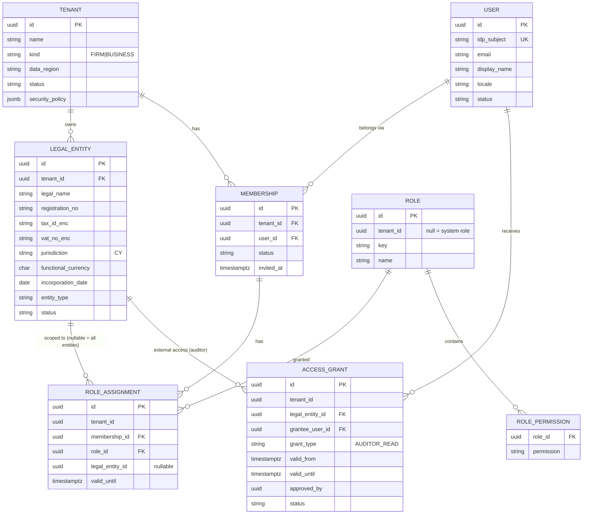
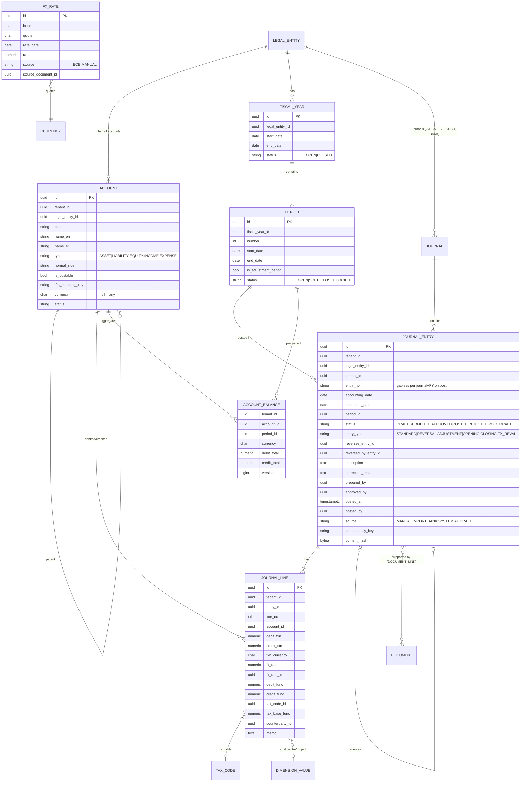
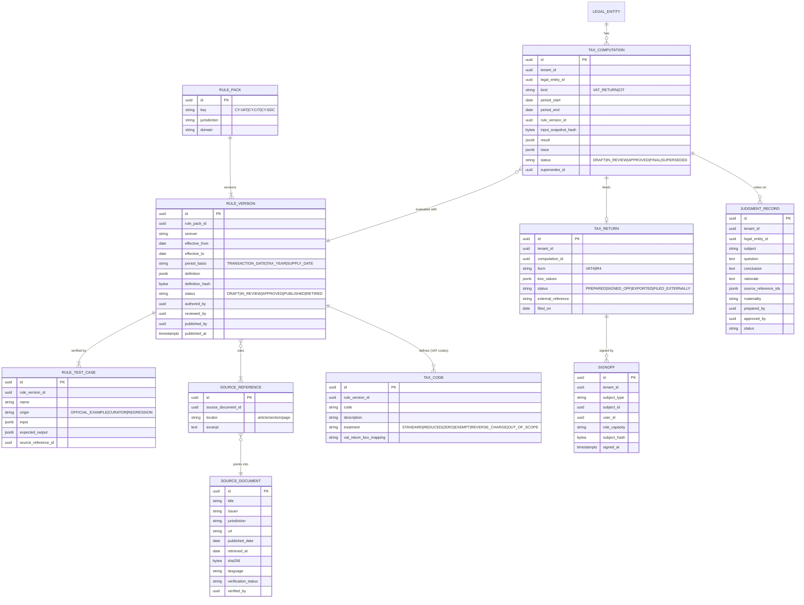
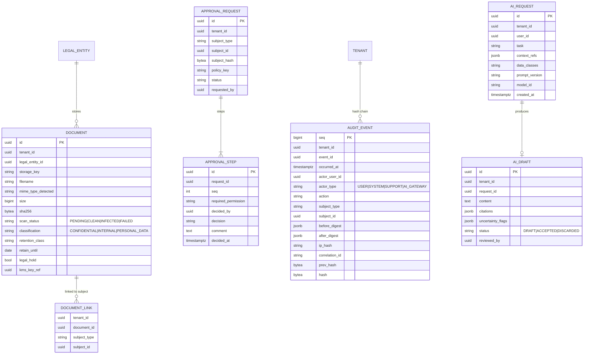

# 03 — Initial Entity-Relationship Model

Status: **DRAFT for review**. This is a logical model. Physical DDL will be produced in Milestone 1 after approval.

Conventions (all tenant-owned tables):
- `id UUID` (v7, time-ordered) as PK, plus `tenant_id UUID NOT NULL` with an RLS policy. FKs to tenant-owned tables are **composite** `(tenant_id, id)` so a row cannot reference another tenant's row even by bug.
- `created_at`, `created_by` on every table; `updated_at`, `updated_by` only on mutable tables.
- Money is `NUMERIC(19,4)` + `currency CHAR(3)`; rates are `NUMERIC(28,10)`.
- No hard deletes of financial/professional records. Records carry a `status` plus retention handling.

## 1. Tenancy & identity

`USER` is global (one person may belong to several tenants, e.g. a freelance auditor). Everything a
user can see is resolved through `MEMBERSHIP` + `ROLE_ASSIGNMENT` + `ACCESS_GRANT`.

## 2. Ledger

## 3. Tax, rules, judgments

`RULE_*` and `SOURCE_*` are **platform-global** (not tenant-owned). They are read-only to tenants and
writable only by the curator role in a separate admin surface.

## 4. Documents, workflow, audit, AI

## 5. Key integrity constraints (DB-enforced)

| Constraint | Mechanism |
|---|---|
| Line has exactly one side, positive | `CHECK ((debit_txn > 0 AND credit_txn = 0) OR (credit_txn > 0 AND debit_txn = 0))`, same for `_func` |
| Entry balances in functional currency | `CONSTRAINT TRIGGER … DEFERRABLE INITIALLY DEFERRED` on entry status → POSTED: `SUM(debit_func) = SUM(credit_func)` and ≥ 2 lines |
| Posted entries immutable | `BEFORE UPDATE OR DELETE` trigger rejects changes to POSTED entries/lines (the only allowed update is setting `reversed_by_entry_id` once) |
| Posting only in OPEN period (or SOFT_CLOSED with privilege flag) | Trigger checks `period.status`; `accounting_date` within period dates |
| Account postable and same entity | Composite FK `(tenant_id, legal_entity_id, account_id)` + trigger on `is_postable` |
| Gapless entry numbers | Per-(journal, fiscal year) counter row locked `FOR UPDATE` at posting |
| Audit log append-only | `REVOKE UPDATE, DELETE` from the app role; trigger as backstop |
| Cross-tenant references impossible | Composite FKs including `tenant_id` + RLS |
| Published rule versions immutable, non-overlapping effective ranges per pack | Trigger + `EXCLUDE USING gist (rule_pack_id WITH =, daterange(effective_from, effective_to) WITH &&) WHERE status='PUBLISHED'` |
